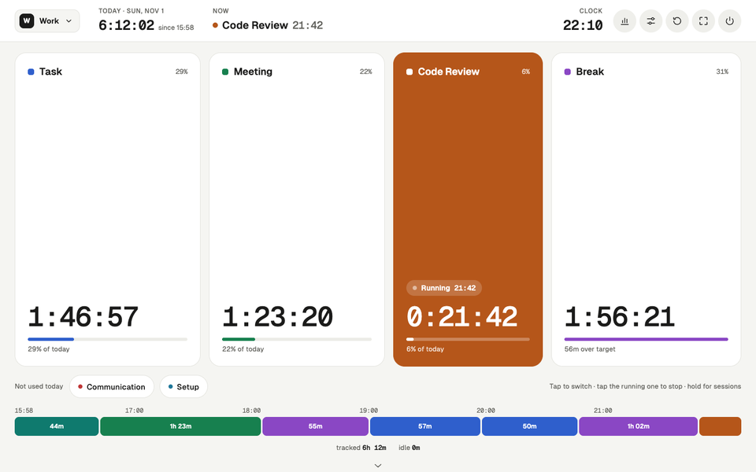
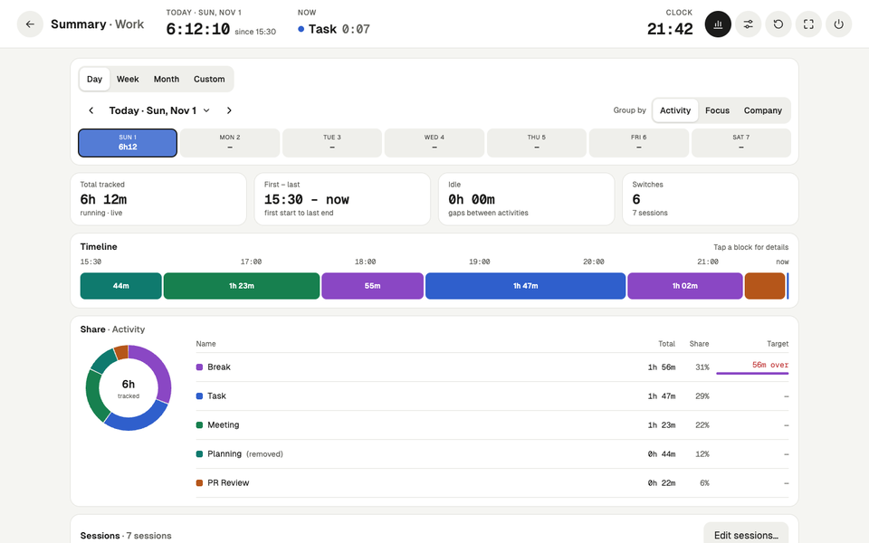
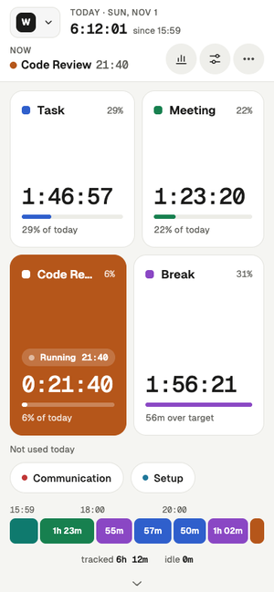

# Tap Time Tracker

A touchscreen "chess clock" for the work day. Tap an activity to start it; tapping another one switches to it, and
tapping the active one stops everything. It tracks today's total, a total per activity and the current run, and you can
backdate a switch ("I actually started this at 14:30"). The Summary shows any day, week, month or range, split by
activity or by your own categories.



More screens, desktop and phone: **[docs/screenshots](docs/screenshots/README.md)**.

| Summary | Phone |
| --- | --- |
|  |  |

Docs: [docs/SPEC.md](docs/SPEC.md) (the full spec), [docs/DESIGN.md](docs/DESIGN.md) (layout rules for changes
without a new design), [docs/SIMILAR-TOOLS.md](docs/SIMILAR-TOOLS.md) (research notes on comparable apps).

## Setup
Preact + TypeScript, built with Vite. Install the dependencies once:
```sh
npm install
```

## Run
It is a website and an installable PWA: open it in a browser, or install it from the browser's menu. There is no
launcher script or desktop entry; close it like any tab or app window. Locally:
```sh
npm run dev                          # Vite dev server with hot reload
npm run build && npx serve dist      # the built site; the app is at /app/
```

### Develop
```sh
npm run dev         # Vite dev server with hot reload (a different origin: its data is separate)
npm run build       # type-check + build to dist/
npm test            # Vitest
npm run typecheck
npm run smoke       # headless Chrome walks every screen with sample data, fails on page errors
npm run screenshots # regenerate docs/screenshots and the demo animations (needs ImageMagick for those)
```
The driver behind the last two (and how to script your own checks) is described in
[.claude/skills/run-time-tracker/SKILL.md](.claude/skills/run-time-tracker/SKILL.md).

### Optional: any static web server
Run `npm run build` and copy `dist/` to any static host (a subpath works too). The root is the landing page (with
privacy and terms pages next to it); the app is at `app/` and can be installed from there as an app, and `app/?demo`
is a demo on sample data in its own throwaway database. Each browser on each device keeps its
own data; nothing syncs, so use export/import to move data. Prefer HTTPS: on plain HTTP the screen isn't kept awake
and storage may be evicted.

### Hosting on Cloudflare Workers (usage stats and feedback)
`wrangler.jsonc` describes one Worker: `dist/` as static assets, served without running any code, and
`worker/index.ts` for `/api/*` only (the site's `/api/feedback`). `npm run build && npx wrangler deploy` uploads both.
- **Deploy:** `.github/workflows/deploy.yml` tests, builds and runs `wrangler deploy` when a release PR is merged
  (release-please creates the release), or by hand from the Actions tab. It needs the repository secrets
  `CLOUDFLARE_API_TOKEN` (the "Edit Cloudflare Workers" token template) and `CLOUDFLARE_ACCOUNT_ID`; `name` in
  `wrangler.jsonc` must be the Worker's name.
- **Usage stats:** create a website in [Umami Cloud](https://cloud.umami.is) and set `VITE_UMAMI_ID` (its website id)
  as a repository variable for the workflow; set `VITE_UMAMI_SRC` too if the account is in another region. Without it
  no stats are sent.
- **Feedback:** create a KV namespace (Storage & Databases → Workers KV) and put its ID in `kv_namespaces` in
  `wrangler.jsonc`, bound as `FEEDBACK`. Without it the form answers "could not be sent". Read messages in the
  dashboard or with `npx wrangler kv key list --binding FEEDBACK --remote`.

See `docs/SPEC.md` §20 for what is collected; the privacy page (`src/site/pages/privacy.html`) says the same in plain words.

## Use
- **Tap** to switch the activity; **tap the active row** to stop all.
- **Long-press** a row to see its sessions and to set "active since…" or "stop all since…"; "Edit sessions…" opens
  the day editor, where ‹ › step to earlier days so any day can be corrected.
- Header: the profile button (with more than one profile), today's total, what is running, the clock, and round
  icons for summary, settings, reset day (archives the day), mini window and full screen. Below the buttons: the strip of
  unused activities, today's timeline and the group totals; scroll down for the footer (links, quick theme switch).
- **Mini window** (desktop Chrome and Edge): a small always-on-top window with the running activity, today's total
  and ‹ ■ › buttons to switch to the previous or next activity or stop, while you work in other apps.
- **Profiles** (Settings → Profiles): separate workspaces, e.g. "Work" and "Home", each with its own activities,
  days, summary, settings (appearance too) and backup file. Only one is open at a time; switch with the profile
  button in the header. A new profile starts with a copy of the open profile's settings.
- **Groups** (Settings → Groups): sort activities into groups inside one profile and switch groups on or off; the
  main screen shows only activities of groups that are on (and ungrouped ones). Several groups can be on at once,
  and a switch stays until you change it.
- **Summary** (header chart icon): a Day, Week, Month or Custom period with ‹ › and a calendar picker; figure tiles,
  the day's timeline or one row per day, the share per activity, and the day's sessions. It ticks live while an
  activity runs.
- **Categories** (Settings → Categories): dimensions such as Focus (Productive / Non-productive) or Company (With
  people / Alone). Each activity picks at most one option per dimension; the Summary can group time by any dimension,
  with the rest shown as "Not set".
- **Settings → Appearance → Theme:** 7 built-in themes (Paper, Graphite, Dune, Tokyo Night, Gruvbox Dark, Nord,
  Solarized Light), fixed or following the system's light/dark mode. **Import theme** reads our own theme files,
  VS Code color themes, base16 (`.yaml`/`.json`), Alacritty `.toml` and iTerm `.itermcolors`. Each activity has one of
  16 color slots (**Activity colors**), so it changes color with the theme. Built-in themes live in
  [`config/themes/`](config/themes/).
- **Settings → Appearance → Main screen:** buttons as Tiles/Rows/Circles, size by today's usage, unused activities
  in a strip, and show or hide the timeline, group totals and footer.
- Activity names are unique. A removed activity can be restored or deleted from the list; its history stays, and
  adding the same name again continues it.
- Switches shorter than a minute are not counted (the time goes to the next or previous activity); change the
  threshold in **Settings → Day → Minimum switch**. The same section sets the reset hour and the first day of the week.
- The screen stays on while the app is open; switch it in the footer (Screen), in the ⋯ More menu on a phone, or in
  **Settings → Device → Keep the screen on**.
- **Language:** English, Ukrainian, Spanish, German, French, Japanese, Portuguese, Turkish, Italian, Persian, Dutch
  or Chinese, from the browser's languages; change it in **Settings → Device → Language** or with the flag picker in
  the website's footer. The website has its own URL per language (`/uk/`, `/de/`, …).
- **Esc** goes back (popup → screen → main). In full screen, hold Esc to leave full screen.

## Languages
Copy lives in [`locales/`](locales/): `locales.json` lists the languages, and each `locales/<code>/` folder holds
`site.json` (shared site strings), one file per site page (`home.json`, `similar.json`) and `app.json` (the app). To
add a language, add it to `locales.json` and copy `locales/en/` to `locales/<code>/` and translate it; a page without a
file in a language is simply not published in it. The build fails when a file misses a key or has an extra one.
Site pages are templates in `src/site/pages/`, rendered per language at build time with canonical, hreflang and the
sitemap generated (see [SPEC §21](docs/SPEC.md#21-languages)).

## Data
- First-run profiles, groups, activities and default settings come from [`config/seed.json`](config/seed.json).
  Edit it before the first start (or on a fresh profile/origin); later changes are made in Settings.
- Imported themes are shared by all profiles; an export embeds the imported themes its profile uses.
- Stored in IndexedDB in the browser, per site address (origin): `localhost:5173` (dev), a local server and the
  website each have their own database.
- Back up with **Settings → Export JSON**, one file per profile. **Import JSON** replaces only the open profile. You can also turn on auto-export on day close.

## Tests
```sh
npm test
```

## Releases
Commit messages (and PR titles, for squash merges) follow [Conventional Commits](https://www.conventionalcommits.org/):
`feat:`, `fix:`, `perf:`, `refactor:`, `docs:`, `test:`, `build:`, `ci:`, `chore:`, with an optional scope
(`feat(summary): …`). A `!` after the type (`feat!: …`) or a `BREAKING CHANGE:` footer marks a breaking change.

[release-please](https://github.com/googleapis/release-please) runs on every push to `main`
(`.github/workflows/release-please.yml`). When there are `feat`, `fix`, `perf` or `revert` commits since the last
release, it opens or updates a release PR that bumps `version` in `package.json` (shown in the app's About) and adds a
section to [CHANGELOG.md](CHANGELOG.md). Merging that PR tags `vX.Y.Z`, creates the GitHub release and deploys the
site. Before 1.0, `feat` bumps the minor version, `fix` the patch, and a breaking change the minor. Other types never
trigger a release and stay out of the changelog. To force a version, add a `Release-As: 1.0.0` footer to a commit.
Settings live in `release-please-config.json` and `.release-please-manifest.json`.
